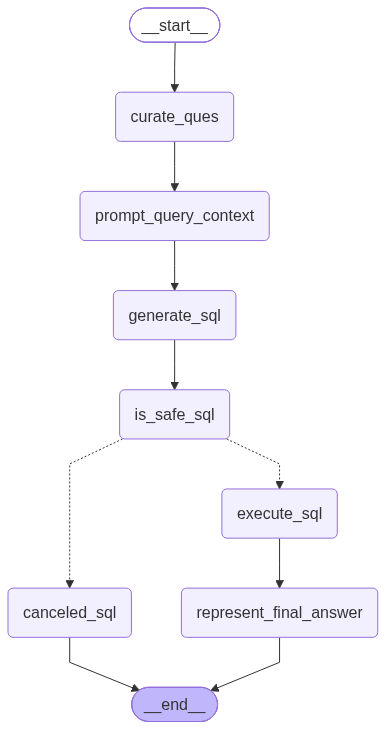

<div align="center">

# 🤖 OLA AI Data Agent

**Ask your data a question in plain English. A LangGraph multi-agent system routes it, writes the SQL or ETL, and answers, with three independent layers keeping the LLM from ever modifying your database.**


</div>

---

## 📋 Table of Contents

- [Overview](#-overview)
- [Architecture](#-architecture)
- [Features](#-features)
- [Safety: Three Layers](#-safety-three-layers-for-llm-written-sql)
- [Prerequisites](#-prerequisites)
- [Installation](#-installation)
- [Project Structure](#-project-structure)
- [Configuration](#-configuration)
- [Usage](#-usage)
- [Agent Descriptions](#-agent-descriptions)
- [Data Models](#-data-models)
- [Examples](#-examples)
- [Known Limitations](#-known-limitations)
- [Credits](#-credits)

---

## 🎯 Overview

**OLA AI Data Agent** takes a natural-language question, decides whether it needs a **database query** or a **file transformation**, and hands it to a specialist sub-agent. The main agent acts as a router; the **SQL Analyst** answers questions from a PostgreSQL database of ride-hailing data, and the **ETL Analyst** extracts and transforms data files.

The project goes beyond a basic text-to-SQL demo by treating LLM-generated SQL as untrusted input and defending against it at three independent levels.

---

## 🏗️ Architecture

```text
                  ┌──────────────┐
                  │  User Query  │
                  └──────┬───────┘
                         ▼
                  ┌──────────────┐
                  │ Router Node  │   classifies: SQL or ETL
                  └──────┬───────┘
              ┌──────────┴──────────┐
              ▼                     ▼
     ┌────────────────┐    ┌────────────────┐
     │  SQL Analyst   │    │  ETL Analyst   │
     └───────┬────────┘    └───────┬────────┘
             │                     │
             ├─► Query Curation    ├─► Extract + Load
             ├─► Schema Context    ├─► Transform + Load
             ├─► SQL Generation    └─► Code Execution
             ├─► Safety Validation
             ├─► Query Execution
             └─► Answer Generation
```

<div align="center">

| Main router | SQL analyst | ETL analyst |
|:---:|:---:|:---:|
|  |  |  |

</div>

### State Flow

1. **User Input**: natural-language question
2. **Router Node**: classifies the question as SQL or ETL
3. **Agent Dispatch**: routes to the matching sub-agent
4. **Processing**: the agent runs its own LangGraph workflow
5. **Output**: the final answer is returned to the user

---

## ✨ Features

### Core Capabilities

- **Intelligent Query Routing**: classifies each question as a SQL or ETL task
- **SQL Analysis Agent**
  - Natural language to SQL conversion
  - Automatic schema context gathering
  - Three-layer safety validation before anything runs
  - Execution on PostgreSQL through a read-only role
- **ETL Agent**
  - Tool-based extract and transform steps (`utils/etl_tools.py`)
  - Pandas code generated from the user's request
- **Tiered LLM Selection**: low / medium / high model tiers, overridable from `.env` with no code changes
- **Structured State**: Pydantic schemas validate every agent's state

---

## 🔒 Safety: Three Layers for LLM-Written SQL

An LLM that writes SQL can also write `DELETE` or `DROP`. No single check is trusted:

| Layer | Mechanism | Type |
|:---|:---|:---|
| **1. Database role** | `SELECT`-only grants, `default_transaction_read_only = on`, `statement_timeout` | Hard barrier, enforced by Postgres |
| **2. SQL guard** | `utils/sql_guard.py` allows one `SELECT`/`WITH` statement and blocks write and DDL keywords | Deterministic, no LLM |
| **3. LLM judge** | A model reviews the generated query before it runs | Probabilistic |

Both deterministic layers have test scripts:

```bash
uv run python utils/check_sql_guard.py   # 5 allowed + 7 blocked queries
uv run python utils/check_readonly.py    # SELECT works; DELETE / CREATE / DROP rejected by Postgres
```

---

## 📦 Prerequisites

- Python 3.14+
- [uv](https://docs.astral.sh/uv/)
- PostgreSQL database
- OpenAI API key

---

## 🚀 Installation

### 1. Clone and install

```bash
git clone https://github.com/Siddhant353/ola-ai-data-agent.git
cd ola-ai-data-agent
uv sync
```

### 2. Environment configuration

```bash
cp .env.example .env      # PowerShell: Copy-Item .env.example .env
```

```ini
# LLM
OPENAI_API_KEY=your_openai_api_key

# Admin database account (used only to load data)
host=localhost
port=5432
database=your_database
user=postgres
password=your_password

# Read-only account (used by the agent)
readonly_user=agent_readonly
readonly_password=your_readonly_password

# Optional: model overrides
LLM_LOW=
LLM_MEDIUM=
LLM_HIGH=
```

### 3. Create the read-only role

Run as an admin; adjust the names and password:

```sql
CREATE ROLE agent_readonly LOGIN PASSWORD 'choose-a-password';
GRANT USAGE ON SCHEMA public TO agent_readonly;
GRANT SELECT ON users, rides, vehicles, payments, ratings TO agent_readonly;
ALTER ROLE agent_readonly SET default_transaction_read_only = on;
ALTER ROLE agent_readonly SET statement_timeout = '10s';
```

### 4. Load the data

```bash
uv run python utils/feed_db.py
```

---

## 📁 Project Structure

```text
ola-ai-data-agent/
├── Agents/
│   ├── Data_agent.py          # Main router agent
│   ├── SQL_analyst.py         # SQL query agent
│   └── ETL_analyst.py         # ETL operations agent
│
├── Models/
│   └── schema.py              # Pydantic schemas for agent state
│
├── utils/
│   ├── database.py            # PostgreSQL utilities
│   ├── etl_tools.py           # ETL toolkit
│   ├── llm_pick.py            # Tiered LLM selection
│   ├── sql_guard.py           # Deterministic SELECT-only guard
│   ├── check_sql_guard.py     # Guard tests
│   ├── check_readonly.py      # Read-only role tests
│   └── feed_db.py             # Loads CSVs into PostgreSQL
│
├── Data/
│   ├── extract/               # Extracted data
│   ├── transform/             # Transformed data
│   └── *.csv                  # users, rides, vehicles, payments, ratings (synthetic)
│
├── main.py                    # Entry point
├── pyproject.toml             # Project metadata and dependencies
└── .env.example               # Configuration template
```

---

## ⚙️ Configuration

### LLM Selection (`utils/llm_pick.py`)

`pick_llm()` returns a model for a given complexity tier. Defaults can be overridden in `.env`.

```python
from utils.llm_pick import pick_llm

llm_fast     = pick_llm("low")      # cost-effective, simple tasks
llm_balanced = pick_llm("medium")   # balanced performance and cost
```

---

## 💻 Usage

```bash
uv run python main.py
```

Type a question at the `You:` prompt. The router decides which agent answers.

---

## 🧠 Agent Descriptions

### 1. Data Agent (Main Router)

**File:** `Agents/Data_agent.py`

- Receives the user's question
- Classifies it as SQL or ETL using structured output
- Routes to the matching sub-agent through conditional edges
- Returns the sub-agent's answer to the user

### 2. SQL Analyst Agent

**File:** `Agents/SQL_analyst.py`

**Workflow**

1. **Query Curation**: refines the question for clarity
2. **Context Gathering**: fetches database schema details
3. **Prompt Construction**: builds the LLM context
4. **SQL Generation**: generates the query
5. **Safety Check**: SELECT-only guard, then LLM judge
6. **Query Execution**: runs the validated query as the read-only role
7. **Answer Generation**: formats the result

### 3. ETL Analyst Agent

**File:** `Agents/ETL_analyst.py`

**Workflow**

1. **Tool Binding**: attaches the ETL tools to the LLM
2. **Intent Understanding**: analyzes the requested transformation
3. **Tool Selection**: picks an extract or transform tool
4. **Code Generation**: generates Pandas code
5. **Execution**: runs the code and saves the output file
6. **Result Reporting**: returns the status

---

## 📊 Data Models

```python
class AgentSchema(BaseModel):            # SQL agent state
    messages: list
    user_question: str
    curated_ques: str
    prompt_query_context: str
    generated_sql_query: str
    is_safe: Literal["YES", "NO"]        # safety verdict
    comments: str
    sql_query_execution_result: str
    final_answer: str
```

---

## 🧪 Examples

**Database query**

```text
You: How many payments are in the database?
```

1. Router classifies as SQL
2. SQL agent fetches schema and generates a `SELECT`
3. Guard and judge approve it
4. Query runs as the read-only role and the answer is returned

**Blocked write attempt**

```text
You: Delete all payments older than 2025
```

1. Router classifies as SQL
2. Generated `DELETE` is rejected by the guard
3. Even if it were not, the database role has no `DELETE` privilege

---

## ⚠️ Known Limitations

- The ETL analyst executes model-generated Python **without a sandbox**. Treat it as a demo and do not point it at sensitive files.
- The LLM judge is probabilistic; the read-only role and SQL guard do the real enforcing.
- Single-turn questions; no memory across runs.
- Built and tested on synthetic data with one PostgreSQL setup.


<div align="center">

Built by **Siddhant Singh** · [GitHub](https://github.com/Siddhant353)

</div>
